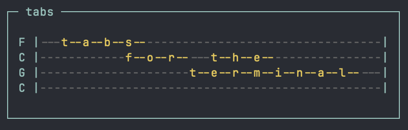

# tabs - guitar and bass tablature manager for the terminal




## Build

You need a fairly recent nim installation (tested with v2.2.10). Then run:

```
atlas init && atlas install
nim c tabs
```

Currently only tested on linux and macos.

## Usage

Just run `./tabs`, by default tabs are stored in ~/.tabs/ and images get saved
in the directory where you are running the tool in.

## License

The code is licensed under the GNU GPL v2.0, see [LICENSE](LICENSE).

JetBrains Mono is © The JetBrains Mono Project Authors and is distributed
under the SIL Open Font License 1.1, see
[assets/fonts/OFL.txt](assets/fonts/OFL.txt).
